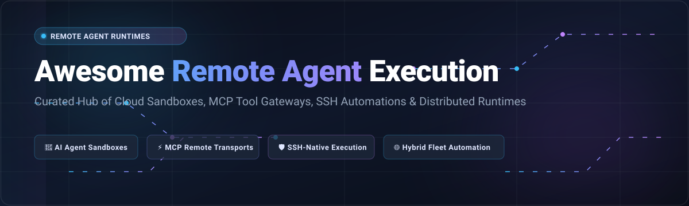

<p align="center">
  
</p>

<p align="center">
  <a href="https://github.com/ishandutta2007/Awesome-Awesome-Awesome"></a>
  <a href="https://discord.gg/jc4xtF58Ve"></a>
  <a href="https://github.com/ishandutta2007/Awesome-Remote-Agent-Execution/stargazers"></a>
  <a href="https://github.com/ishandutta2007/Awesome-Remote-Agent-Execution/network/members"></a>
  <a href="https://github.com/ishandutta2007/Awesome-Remote-Agent-Execution/blob/main/LICENSE"></a>
  <a href="https://github.com/ishandutta2007/Awesome-Remote-Agent-Execution/pulls"></a>
  <a href="https://github.com/ishandutta2007"></a>
</p>

---

# 🤖 Awesome Remote Agent Execution

> A curated directory of tools, frameworks, SaaS platforms, and open-source runtimes for **remote AI agent execution**, **Model Context Protocol (MCP) gateways**, **secure cloud sandboxes**, **SSH-native automation**, and **distributed runbook orchestration**.

Whether you are building autonomous coding agents that manipulate files on remote virtual machines, orchestrating distributed tool calls across multi-cloud infrastructure, or provisioning secure ephemeral sandboxes for untrusted agent code execution, this directory tracks the ecosystem's top tools.

---

## 📑 Table of Contents

- [🌐 Sector Overview & Market Dynamics](#-sector-overview--market-dynamics)
- [☁️ SaaS & Managed Hosted Platforms](#️-saas--managed-hosted-platforms)
- [🛠️ Open-Source GitHub Projects](#️-open-source-github-projects)
- [💡 Architectural Patterns & Framework Selection](#-architectural-patterns--framework-selection)
- [🤝 How to Contribute](#-how-to-contribute)
- [⚠️ Security & Operational Disclaimer](#️-security--operational-disclaimer)
- [⭐ Star History](#-star-history)
- [💖 Support & Sponsoring](#-support--sponsoring)

---

## 🌐 Sector Overview & Market Dynamics

The global market for **IT infrastructure automation, remote agent runtimes, and distributed workload orchestration** is estimated at **$14.2 Billion** and projected to exceed **$38.5 Billion by 2030**, advancing at a robust compound annual growth rate (**CAGR of 18.2%**), propelled by the rapid emergence of agentic AI coding assistants and autonomous cloud operations.

The sector is currently **moderately fragmented**: 
- Foundational cloud hyperscalers (**Microsoft Azure, Alphabet/Google Cloud, Amazon Web Services**) dominate baseline fleet compute, identity, and security perimeters.
- Established infrastructure-as-code and configuration management titans (**IBM/Red Hat, HashiCorp, Broadcom/VMware, Progress, Perforce**) provide mature policy-as-code, audit governance, and multi-node execution engines.
- A fast-accelerating tier of specialized agentic infrastructure startups (**E2B, Modal, Spacelift, Daytona**) and open-source MCP protocol gateways are unbundling traditional execution pipelines into ephemeral, microsecond-latency sandboxes tailored specifically for LLM tool invocation.

Because enterprise security mandates strict zero-trust boundary isolation while developer teams demand lightweight, agent-first API ergonomics, the landscape resists a single "winner-take-all" monopoly, sustaining dynamic co-existence between legacy fleet managers and next-generation agent runtimes.

---

## ☁️ SaaS & Managed Hosted Platforms

Below are leading SaaS and managed enterprise platforms for remote script dispatch, agent sandboxing, cloud runbooks, and infrastructure automation, **sorted descending by company valuation / market capitalization**:

| 🏆 Rank | 🏢 Platform & Vendor | 📈 Company Valuation / Size | 🏷️ Starting Tier Pricing | 🎁 Free Tier / Trial Limits | ⚙️ Remote Agent Execution Architecture |
| :---: | :--- | :--- | :--- | :--- | :--- |
| **1** | **[Azure Automation](https://azure.microsoft.com/en-us/products/automation/)**<br>*(Microsoft)* | **$3.12 Trillion** Market Cap<br>(FY24 Revenue: $245B) | **$0.002 / minute** for Process Automation job run time beyond the free allowance | **500 minutes/month free** job runtime + **744 watcher hours/month free forever**; first 5 non-Azure hybrid nodes free | Cloud runbooks (PowerShell & Python) executed across Azure VMs and hybrid on-premises worker groups via outbound HTTPS. |
| **2** | **[Google Cloud Deployment Manager](https://cloud.google.com/deployment-manager)**<br>*(Alphabet / Google)* | **$2.14 Trillion** Market Cap<br>(FY24 Revenue: $350B) | **$0.00 service fee**<br>(Managed resources charged at standard GCP rates, e.g. e2-standard-2 at $0.067/hr) | **90-day free trial with $300 cloud credits**; permanent **GCP Always Free Tier** (1 e2-micro compute instance, 2M Cloud Function calls/mo) | Declarative YAML/Python execution engine orchestrating parallel resource provisioning across Google Cloud project fleets. |
| **3** | **[AWS Systems Manager (SSM)](https://aws.amazon.com/systems-manager/)**<br>*(Amazon Web Services)* | **$1.95 Trillion** Market Cap<br>(FY24 Revenue: $600B+) | **$0.00 service fee** for core features (Run Command, Session Manager, Patch Manager) | **Always Free** for unlimited EC2 and on-premises nodes managed through core Run Command & Session Manager (Automation runbooks billed per step over tier) | Agent-based fleet management (SSM Agent) enabling audit-logged shell access and remote script execution without open inbound SSH ports or bastion hosts. |
| **4** | **[SaltStack Enterprise / Aria Config](https://www.vmware.com/products/saltstack.html)**<br>*(Broadcom / VMware)* | **$840 Billion** Market Cap<br>(VMware acquired for $69B) | **$135 per core / year**<br>(Licensed via VMware vSphere Foundation / Aria Suite) | **60-day enterprise evaluation trial** with full feature capabilities up to 100 managed nodes/cores via sales PoC | Event-driven, sub-second remote execution bus using ZeroMQ/SSH to coordinate parallel configuration commands across massive fleets. |
| **5** | **[Ansible Automation Platform](https://www.redhat.com/en/technologies/management/ansible)**<br>*(IBM / Red Hat)* | **$205 Billion** IBM Parent<br>(Red Hat acquired for $34B) | **$13,000 / year**<br>(Standard Edition entry pack of 100 managed nodes, ~$130/node/yr) | **60-day free product evaluation trial** fully functional for up to **100 managed nodes** with self-support | Centralized Automation Controller (formerly Tower) providing RBAC, visual workflow DAGs, and agentless remote execution over OpenSSH. |
| **6** | **[Terraform Cloud (HCP Terraform)](https://www.hashicorp.com/products/terraform)**<br>*(IBM / HashiCorp)* | **$205 Billion** IBM Parent<br>(HashiCorp acquired for $6.4B) | **$0.00014 / resource-hour**<br>(~$0.10 per managed resource/month for resources above 500) | **Free forever for up to 500 managed resources**, unlimited user seats, 1 concurrent remote runner, and private module registry | Managed TACO platform providing remote plan/apply runs, VCS triggers, private runner agents, and Sentinel/OPA policy-as-code guardrails. |
| **7** | **[Chef Automate](https://www.chef.io/)**<br>*(Progress Software)* | **$2.7 Billion** Market Cap<br>(Chef acquired for $220M) | **$59 per node / year**<br>(Business Tier; cloud marketplace entry packs start at $7,000/yr for 50 nodes) | **60-day free trial license** with unrestricted access to Chef Automate, compliance auditing, and fleet dashboards | Automated desired-state policy enforcement, Continuous compliance scanning, and remote node recipe execution. |
| **8** | **[Puppet Enterprise](https://puppet.com/)**<br>*(Perforce Software)* | **~$2.0 Billion** Valuation<br>(Private Equity owned) | **$120 per node / year**<br>(Standard Enterprise tier baseline on multi-year agreements) | **10 nodes free forever** with no time expiration; Puppet Core free forever up to 25 nodes | Agent-driven infrastructure state enforcement, continuous drift correction, and declarative task orchestration across hybrid clouds. |
| **9** | **[RunDeck / Process Automation](https://www.pagerduty.com/platform/automation/)**<br>*(PagerDuty)* | **$1.8 Billion** Market Cap<br>(FY24 Revenue: $450M) | **$125 per user / month**<br>(Hosted Runbook Automation Cloud baseline) | **14-day free trial** of Cloud Runbook Automation (up to 10 users, full feature access, no credit card required) | Self-service runbook automation service dispatching automated incident remediation and scripted workflows across multi-node SSH/WinRM targets. |
| **10** | **[Modal](https://modal.com/)**<br>*(Modal Labs)* | **~$300 Million** Valuation<br>(Series A funded) | **$250 / month** for Team Plan<br>(or pay-as-you-go above credit at $0.00003/core-sec) | **$30 / month free compute credits forever** (resets monthly; no expiration; includes container execution & GPU test access) | Ultra-fast serverless cloud container runtime executing Python AI agent tasks and tool loops in microsecond spin-up sandboxes. |
| **11** | **[Spacelift](https://spacelift.io/)**<br>*(Spacelift)* | **~$200 Million** Valuation<br>(Series B, $22M+ raised) | **$20,000 / year**<br>(Starter+ Tier subscription including 1 private worker) | **Free forever for 2 users**, 1 public worker, and unlimited runs across Terraform, OpenTofu, Pulumi, Ansible, and Kubernetes; **14-day trial** for paid tiers | Cloud-native multi-IaC orchestration platform executing runs inside isolated private or public worker environments with drift detection. |
| **12** | **[E2B](https://e2b.dev/)**<br>*(E2B)* | **~$50 Million** Valuation<br>(Backed by Decibel & GitHub) | **$150 / month** for Pro Tier<br>(or pay-as-you-go at $0.05 / sandbox-hour) | **$100 free usage credit on sign-up**, up to 20 concurrent sandboxes with 1-hour session timeouts | Secure cloud firecracker microVM sandboxes designed specifically for AI code interpreters and LLM agents to execute untrusted code remotely. |

---

## 🛠️ Open-Source GitHub Projects

Explore the leading open-source repositories powering remote agent command execution, SSH toolbridges, MCP servers, and cloud sandboxes. 

> **Sorted descending by GitHub stargazers count:**

---

### 1. [Model Context Protocol Servers](https://github.com/modelcontextprotocol/servers) [](https://github.com/modelcontextprotocol/servers/stargazers)
- **Repo**: `modelcontextprotocol/servers` | **License**: MIT
- **Focus**: The official reference repository of Model Context Protocol (MCP) servers maintained by Anthropic and the open-source community.
- **Capabilities**: Features reference implementations for remote execution, including SSH execution bridges, Docker container runners, filesystem manipulators, and secure command line tool endpoints that allow LLM agents to perform remote actions consistently.
- **Best For**: Native integration with Claude Code, Cursor, and any MCP-compliant agent runtime.

---

### 2. [Daytona](https://github.com/daytonaio/daytona) [](https://github.com/daytonaio/daytona/stargazers)
- **Repo**: `daytonaio/daytona` | **License**: Apache-2.0
- **Focus**: Open-source development environment orchestrator and remote workspace manager.
- **Capabilities**: Provides automated provisioning and isolation of complete remote development targets with a single command. Enables AI agents to spin up remote sandboxes, clone repositories, execute terminal commands, and maintain persistent workspace state across agent runs.
- **Best For**: Autonomous coding agents requiring full dev environments with sandboxed terminal control.

---

### 3. [Ansible](https://github.com/ansible/ansible) [](https://github.com/ansible/ansible/stargazers)
- **Repo**: `ansible/ansible` | **License**: GPL-3.0
- **Focus**: The standard in agentless IT automation and remote server orchestration.
- **Capabilities**: Executes idempotent modules and YAML playbooks across hundreds of remote Linux and Windows nodes via standard OpenSSH and WinRM without installing background agents on target systems.
- **Best For**: Fleet-scale configuration management, multi-machine state enforcement, and agentless command orchestration.

---

### 4. [Terraform](https://github.com/hashicorp/terraform) [](https://github.com/hashicorp/terraform/stargazers)
- **Repo**: `hashicorp/terraform` | **License**: BSL-1.1
- **Focus**: Industry-defining declarative Infrastructure as Code engine.
- **Capabilities**: Provisions and governs distributed infrastructure across 3,000+ cloud providers. Supports remote execution runners, distributed state locks, and plan/apply workflows that autonomous agent systems use to configure infrastructure.
- **Best For**: Declarative infrastructure provisioning across multi-cloud environments.

---

### 5. [OpenTofu](https://github.com/opentofu/opentofu) [](https://github.com/opentofu/opentofu/stargazers)
- **Repo**: `opentofu/opentofu` | **License**: MPL-2.0
- **Focus**: The truly open-source, Linux Foundation-governed fork of Terraform.
- **Capabilities**: Provides backward-compatible, declarative infrastructure management with remote state backends, parallel execution graphs, and plugin extensibility for agentic tool use.
- **Best For**: Open-source purists needing reliable, non-BSL declarative cloud orchestration.

---

### 6. [Temporal](https://github.com/temporalio/temporal) [](https://github.com/temporalio/temporal/stargazers)
- **Repo**: `temporalio/temporal` | **License**: MIT
- **Focus**: Durable execution engine for fault-tolerant, long-running agent workflows.
- **Capabilities**: Preserves complete execution state across network partitions, server restarts, and API timeouts. Enables AI agents to dispatch distributed, remote multi-step activities with automatic retries, compensation logic, and guaranteed execution semantics.
- **Best For**: Multi-day or resilient autonomous agent workflows executing complex remote tasks.

---

### 7. [Dagger](https://github.com/dagger/dagger) [](https://github.com/dagger/dagger/stargazers)
- **Repo**: `dagger/dagger` | **License**: Apache-2.0
- **Focus**: Programmable container engine for running isolated tool pipelines and build workflows.
- **Capabilities**: Lets developers and AI agents define remote or local execution pipelines as code in Python, TypeScript, or Go. Uses BuildKit caching for rapid containerized command execution with complete isolation.
- **Best For**: Sandboxed CI/CD, tool execution pipelines, and reproducible agent build environments.

---

### 8. [Salt (SaltStack)](https://github.com/saltstack/salt) [](https://github.com/saltstack/salt/stargazers)
- **Repo**: `saltstack/salt` | **License**: Apache-2.0
- **Focus**: High-speed, event-driven remote execution engine and configuration manager.
- **Capabilities**: Uses a ZeroMQ communication bus to broadcast commands simultaneously to thousands of remote minions in milliseconds, returning real-time command output.
- **Best For**: Real-time parallel command execution and high-scale fleet orchestration.

---

### 9. [AWX](https://github.com/ansible/awx) [](https://github.com/ansible/awx/stargazers)
- **Repo**: `ansible/awx` | **License**: Apache-2.0
- **Focus**: The open-source upstream project for Red Hat Ansible Automation Platform.
- **Capabilities**: Provides a modern web UI, REST API, job queuing engine, credentials vault, and RBAC for triggering Ansible playbooks across remote nodes asynchronously.
- **Best For**: Self-hosting an enterprise-grade REST API for agentic Ansible job dispatch.

---

### 10. [Fabric](https://github.com/fabric/fabric) [](https://github.com/fabric/fabric/stargazers)
- **Repo**: `fabric/fabric` | **License**: BSD-2-Clause
- **Focus**: High-level Python library designed to execute remote shell commands over SSH.
- **Capabilities**: Wraps Paramiko with clean, idiomatic Python APIs for executing remote shell commands (`Connection.run()`), streaming output, transferring files via SFTP, and managing multi-host deployments.
- **Best For**: Python-based agent runtimes needing straightforward SSH command execution.

---

### 11. [E2B Sandboxes](https://github.com/e2b-dev/E2B) [](https://github.com/e2b-dev/E2B/stargazers)
- **Repo**: `e2b-dev/E2B` | **License**: Apache-2.0
- **Focus**: Secure cloud sandboxes specifically engineered for AI agents and code interpreters.
- **Capabilities**: Spins up isolated Linux microVMs within ~150 milliseconds. Agents can execute arbitrary Python, JavaScript, and Bash code, browse the web, create files, and inspect outputs in isolated sandboxes.
- **Best For**: Safe execution of untrusted AI-generated code and tool workflows.

---

### 12. [Semaphore](https://github.com/semaphoreui/semaphore) [](https://github.com/semaphoreui/semaphore/stargazers)
- **Repo**: `semaphoreui/semaphore` | **License**: MIT
- **Focus**: Modern, lightweight open-source alternative to Ansible Tower / AWX.
- **Capabilities**: Written in Go; orchestrates Ansible playbooks, Terraform/OpenTofu configurations, Bash scripts, and Pulumi code via a responsive UI and REST API with zero bloat.
- **Best For**: Lightweight, self-hosted UI and API dispatch for multi-tool remote tasks.

---

### 13. [SkyPilot](https://github.com/skypilot-org/skypilot) [](https://github.com/skypilot-org/skypilot/stargazers)
- **Repo**: `skypilot-org/skypilot` | **License**: Apache-2.0
- **Focus**: Framework for running AI workloads and remote jobs seamlessly on any cloud or GPU provider.
- **Capabilities**: Automatically finds the cheapest GPU/CPU compute across AWS, GCP, Azure, and Lambda Cloud, provisions resources, syncs code, and runs jobs remotely with automatic teardown.
- **Best For**: AI agents orchestrating remote model fine-tuning, batch compute, and distributed GPU tasks.

---

### 14. [Paramiko](https://github.com/paramiko/paramiko) [](https://github.com/paramiko/paramiko/stargazers)
- **Repo**: `paramiko/paramiko` | **License**: LGPL-2.1
- **Focus**: The foundational Python implementation of the SSHv2 protocol.
- **Capabilities**: Low-level, battle-tested library providing direct cryptographic SSH client and server primitives, multiplexed channels, SFTP clients, and agent forwarding used by countless automation platforms.
- **Best For**: Custom Python tools requiring low-level SSH protocol control.

---

### 15. [Atlantis](https://github.com/runatlantis/atlantis) [](https://github.com/runatlantis/atlantis/stargazers)
- **Repo**: `runatlantis/atlantis` | **License**: Apache-2.0
- **Focus**: Pull request automation for Terraform and OpenTofu.
- **Capabilities**: Executes `terraform plan` and `apply` directly from PR comment commands in GitHub, GitLab, or Bitbucket with fine-grained plan locking and output verification.
- **Best For**: GitOps-driven remote Terraform execution triggered directly from pull requests.

---

### 16. [Bifrost](https://github.com/maximhq/bifrost) [](https://github.com/maximhq/bifrost/stargazers)
- **Repo**: `maximhq/bifrost` | **License**: Apache-2.0
- **Focus**: MCP-native gateway with remote execution capabilities across SSH and Docker targets.
- **Capabilities**: Connects external tool servers via STDIO, HTTP, or SSE with OAuth 2.0 authentication. Agent Mode enables autonomous tool execution with auto-approval, while Code Mode lets AI write Python to orchestrate multiple tools in a sandbox (reducing token usage by 50%+). Supports remote targets via pair codes or SSH keys.
- **Best For**: AI agents needing to execute tools on remote machines with MCP ecosystem compatibility.
- *Security notice: Ensure upgrade to 2.1.0+ and enable governance auth to prevent unauthenticated RCE.*

---

### 17. [Puppet Core](https://github.com/puppetlabs/puppet) [](https://github.com/puppetlabs/puppet/stargazers)
- **Repo**: `puppetlabs/puppet` | **License**: Apache-2.0
- **Focus**: Declarative configuration management and node enforcement.
- **Capabilities**: Uses a declarative domain-specific language (DSL) to describe system state, enforcing configuration through target node agents and reporting compliance back to PuppetDB.
- **Best For**: Long-term state enforcement and drift prevention across enterprise server fleets.

---

### 18. [RunDeck Community](https://github.com/rundeck/rundeck) [](https://github.com/rundeck/rundeck/stargazers)
- **Repo**: `rundeck/rundeck` | **License**: Apache-2.0
- **Focus**: Open-source runbook automation engine and job scheduler.
- **Capabilities**: Web console and CLI to turn existing operational scripts and tools into secure, auditable self-service automation jobs with node filtering and access control.
- **Best For**: Turning ad-hoc administrative scripts into auditable remote automation endpoints.

---

### 19. [assh (Advanced SSH Config)](https://github.com/moul/assh) [](https://github.com/moul/assh/stargazers)
- **Repo**: `moul/assh` | **License**: MIT
- **Focus**: Advanced OpenSSH client config generator and connection gateway tool.
- **Capabilities**: Transparently configures multi-hop SSH proxy chains, jump hosts, regex host matching, automatic gateway fallback, and connection multiplexing for command-line agents.
- **Best For**: Simplifying complex multi-bastion SSH network topologies for agent CLI runtimes.

---

### 20. [Terrakube](https://github.com/terrakube-io/terrakube) [](https://github.com/terrakube-io/terrakube/stargazers)
- **Repo**: `terrakube-io/terrakube` | **License**: Apache-2.0
- **Focus**: Open-source alternative to Terraform Cloud.
- **Capabilities**: Features remote run execution, state management, workspace isolation, private registry, and native support for both Terraform and OpenTofu on self-hosted infrastructure.
- **Best For**: Self-hosted TACO platform operations without SaaS vendor lock-in.

---

### 21. [rrun](https://github.com/buster/rrun) [](https://github.com/buster/rrun/stargazers)
- **Repo**: `buster/rrun` | **License**: MIT
- **Focus**: Stateless CLI and agent skill for safe remote script execution.
- **Capabilities**: Dispatches one-off script executions to remote machines over SSH without exposing credentials or root passwords to the calling LLM coding agent.
- **Best For**: Lightweight remote script execution where full configuration management is overkill.

---

### 22. [kojo](https://github.com/loppo-llc/kojo) [](https://github.com/loppo-llc/kojo)
- **Repo**: `loppo-llc/kojo` | **License**: MIT
- **Focus**: Mobile web bridge to remotely operate AI coding CLIs.
- **Capabilities**: Single Go binary embedding a web UI; connects through tmux-backed sessions and Tailscale P2P WireGuard tunnels to allow developers to drive Claude Code or Codex remotely from phones or tablets.
- **Best For**: Operating terminal coding agents on remote machines from mobile devices.

---

### 23. [OpenAgentFleet](https://github.com/robbyczgw-cla/openagentfleet) [](https://github.com/robbyczgw-cla/openagentfleet/stargazers)
- **Repo**: `robbyczgw-cla/openagentfleet` | **License**: MIT
- **Focus**: Self-hosted fleet manager for autonomous computer-use agents.
- **Capabilities**: Provisions disposable containerized Linux desktop environments with browser-streaming output, enabling vision-based computer-use agents to run remotely and securely.
- **Best For**: Computer-use GUI agents needing disposable remote desktop targets.

---

### 24. [tramp](https://github.com/marcfargas/tramp) [](https://github.com/marcfargas/tramp/stargazers)
- **Repo**: `marcfargas/tramp` | **License**: MIT
- **Focus**: Transparent remote execution MCP server for AI coding agents.
- **Capabilities**: *"The agent stays local. Tools execute remotely."* Mirrors Claude Code built-in tool signatures (`bash`, `read`, `write`, `edit`, `glob`, `grep`, `ls`) over multiplexed SSH channels or Docker containers.
- **Best For**: Claude Code and MCP agents needing transparent remote execution without modifying local workflows.

---

### 25. [agent-runtime (devpilot-agent)](https://pypi.org/project/devpilot-agent/)
- **Distribution**: PyPI / Package
- **Focus**: Lightweight agent runtime turning any machine into an AI-controllable compute target.
- **Capabilities**: Zero-dependency async command server providing `POST /exec`, job polling, ConPTY WebSocket terminals, ACP protocol compatibility, and automated API-key auth.
- **Best For**: Rapidly transforming VMs and edge targets into agent-controllable nodes.

---

## 💡 Architectural Patterns & Framework Selection

When designing a remote agent execution architecture, choose your transport layer and runtime according to your trust model and operational scope:

```
┌────────────────────────────────────────────────────────────────────────┐
│                        AI Agent Layer (Claude, Cursor, Codex)          │
└───────────────────────────────────┬────────────────────────────────────┘
                                    │ Tool Invocations
        ┌───────────────────────────┴───────────────────────────┐
        ▼                                                       ▼
┌───────────────────────────────┐               ┌───────────────────────────────┐
│     MCP Tool Gateways         │               │     SSH & Runbook Transports  │
│  (Bifrost, tramp, MCP Servers)│               │  (Ansible, Fabric, SSM, AWX)  │
└───────────────┬───────────────┘               └───────────────┬───────────────┘
                │ Remote Dispatch                               │ Outbound / SSH
        ┌───────┴───────────────────────┬───────────────────────┴───────┐
        ▼                               ▼                               ▼
┌──────────────────┐            ┌──────────────────┐            ┌──────────────────┐
│ Ephemeral Cloud  │            │ Remote Linux /   │            │ Multi-Node Fleet │
│ Sandboxes        │            │ Windows VMs      │            │ Clusters         │
│ (E2B, Modal)     │            │ (AWS SSM, Azure) │            │ (Temporal, Salt) │
└──────────────────┘            └──────────────────┘            └──────────────────┘
```

1. **Transparent Coding Agent Tooling**: Use **tramp** or **Bifrost** when you want your local Claude Code or Cursor agent to manipulate files and execute shell commands directly on remote servers without changing tool syntax.
2. **Untrusted Code Execution**: Use **E2B** or **Modal** to spin up microsecond microVM sandboxes where AI-generated Python or shell scripts can run safely with isolated network rules.
3. **Enterprise Fleet Compliance**: Combine **AWS Systems Manager** or **Ansible Automation Platform** to enforce role-based access control, cryptographic verification, and tamper-proof audit trails.
4. **Resilient Distributed Workflows**: Deploy **Temporal** to orchestrate multi-step agent actions that survive network blips, host reboots, and prolonged service outages.

---

## 🤝 How to Contribute

Contributions are warmly welcomed! To add or update an entry:

1. 🍴 **Fork** this repository.
2. 📝 **Edit `README.md`** following the existing format:
   - For SaaS: Platform name, official URL, parent company valuation, specific starting tier price, exact free tier / trial terms, and key remote capabilities.
   - For Open-Source: Repository name, link, star count badge, license, core focus, and ideal use case.
3. 🔍 **Verify links** and keep descriptions factual, concise, and free from marketing fluff.
4. 🚀 **Submit a Pull Request** with a brief summary of what was added or updated.

---

## ⚠️ Security & Operational Disclaimer

- **Community-Curated List**: This repository provides architectural information for educational and research purposes. Inclusion does not imply official endorsement.
- **Remote Code Execution Risks**: Remote execution tools grant direct compute and filesystem control. Always run agents under least-privilege service accounts, isolate network perimeters, and implement strict secret redaction.
- **Historical Vulnerability Awareness**: As with any remote tool gateway, keep software updated. For example, Bifrost versions prior to 2.1.0 contained an unauthenticated RCE vulnerability (CVE-2026-90898) via stdio MCP registration; ensure upgrades and active governance authentication.
- **Context Clarity**: Tools like `tramp` expose remote tools mirroring local signatures; ensure your agent's system prompt clearly differentiates local actions from remote operations via context resources.

---

## ⭐ Star History

[](https://star-history.dera.page/#ishandutta2007/Awesome-Remote-Agent-Execution&type=date&legend=top-left)

---

## 💖 Support & Sponsoring

If you found this directory useful for architecting your agentic systems, automating infrastructure, or choosing remote execution tools:

- ⭐ **Star this repo** to help others discover it
- 🍴 **Fork and share** with your engineering team
- ☕ **Support Maintenance**: Sponsor this and other open-source projects via the [GitHub Sponsor Dashboard](https://github.com/sponsors/ishandutta2007)

---

<p align="center">
  <sub>Curated with care by <a href="https://github.com/ishandutta2007">Ishan Dutta</a> and the global open-source community. Part of the <a href="https://github.com/ishandutta2007/Awesome-Awesome-Awesome">Awesome-Awesome-Awesome</a> collection.</sub>
</p>
